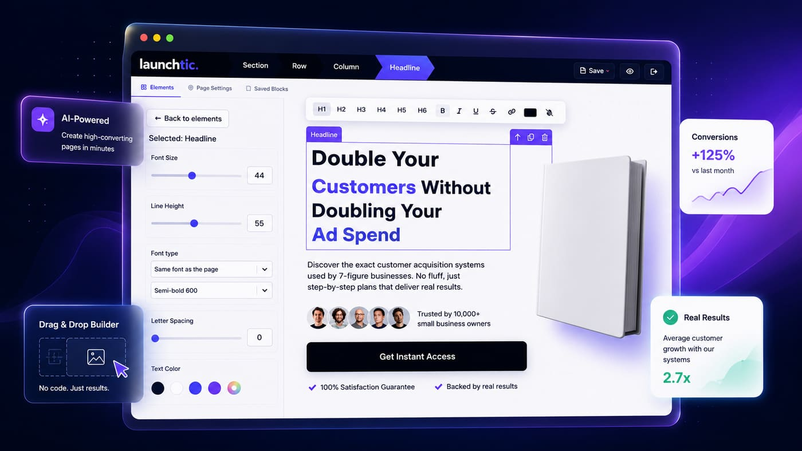
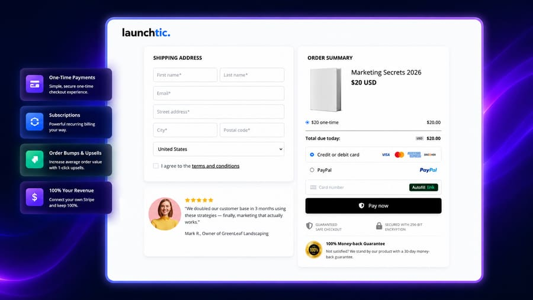
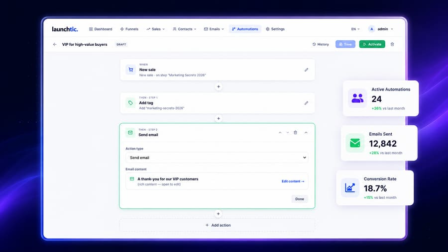
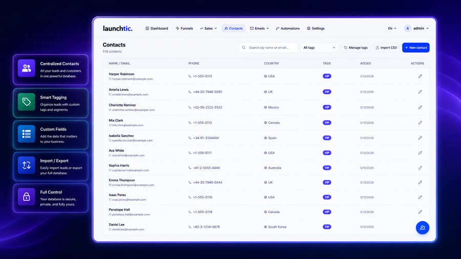

# Launchtic

> Fair-code funnel builder with native AI capabilities. Build landing pages, sales funnels and email campaigns visually. A self-hosted alternative to ClickFunnels, GoHighLevel and systeme.io.

[](LICENSE.md)
[]()

Page builder, checkout, email automation and AI copy tools in one platform you run on your own server and domain. No monthly SaaS fees, no per-contact pricing.

**[Live demo](https://demo.launchtic.com)** · [Website](https://launchtic.com) · [Docs](https://launchtic.com/docs)



| Checkout | Automations | Contacts |
|---|---|---|
|  |  |  |

## Features

- **Drag-and-drop page builder** — desktop + mobile breakpoints
- **Funnels** — Landing → Checkout → Upsell / Downsell → Thank You, custom domain per funnel
- **Payments** — Stripe + PayPal, one-time + subscriptions, order bumps
- **Email** — broadcasts, sequences, behavior-triggered automations
- **CRM** — contacts, tags, pipelines
- **Built-in AI** — rewrite copy with your own OpenAI / Anthropic / Gemini key
- **Templates** — starter page + email templates, more as [add-ons](https://launchtic.com/add-ons)
- **Self-host friendly** — one Docker Compose stack, automatic SSL via Caddy

## Install

On a fresh Ubuntu/Debian VPS (Docker is installed for you). No license needed:

```bash
curl -fsSL https://launchtic.com/install | bash
```

Open `http://<server-ip>` and follow the wizard: create the admin account, point two subdomains (dashboard + pages) at the server. SSL is automatic.

Have an Agency key or an add-on? Paste it in **Settings → License & Updates**.

Update: `cd launchtic && curl -fsSL https://launchtic.com/update | bash`

## Local development

```bash
git clone https://github.com/launchtic/launchtic.git && cd launchtic
pnpm install
pnpm infra:up              # Postgres + Redis (docker-compose.dev.yml)
cp .env.example .env
pnpm db:migrate
pnpm dev:all               # web, renderer, worker
```

Dashboard http://localhost:3000 · Pages http://localhost:3001

Stack: Next.js 15, React 19, Craft.js, Prisma + PostgreSQL, Redis + BullMQ, Caddy.

## License

Source-available under the **[Sustainable Use License](LICENSE.md)**.

**You may** self-host it for your own business (any size), modify it for your own use, and set it up on a client's own server for that client.

**You need an [Agency plan](https://launchtic.com/pricing)** to run funnels for multiple clients from your own installation, or to white-label it.

**You may not** (without a written agreement) offer Launchtic as a hosted service to third parties, resell it, or build a competing funnel / page builder from it.

Add-on template packs are covered by the [Add-on License](https://launchtic.com/add-on-license). Commercial / OEM inquiries: **hello@launchtic.com**.

"Launchtic" and its logo are trademarks of Launchtic; the license grants no trademark rights.

## Contributing

We don't accept pull requests. Bug reports and feature requests are welcome in [Issues](../../issues) — see [CONTRIBUTING.md](CONTRIBUTING.md). Security issues: [SECURITY.md](SECURITY.md).
